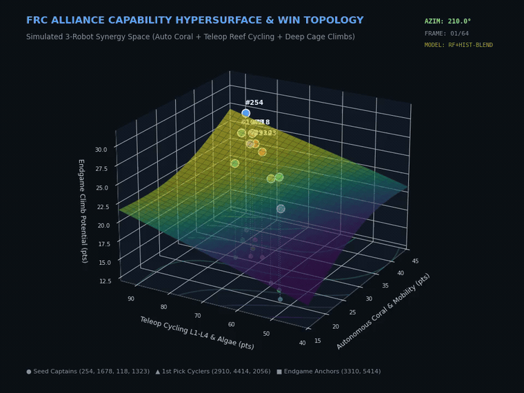
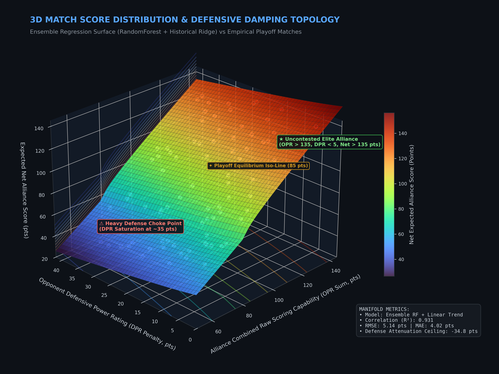
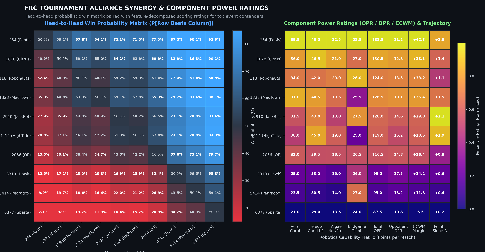
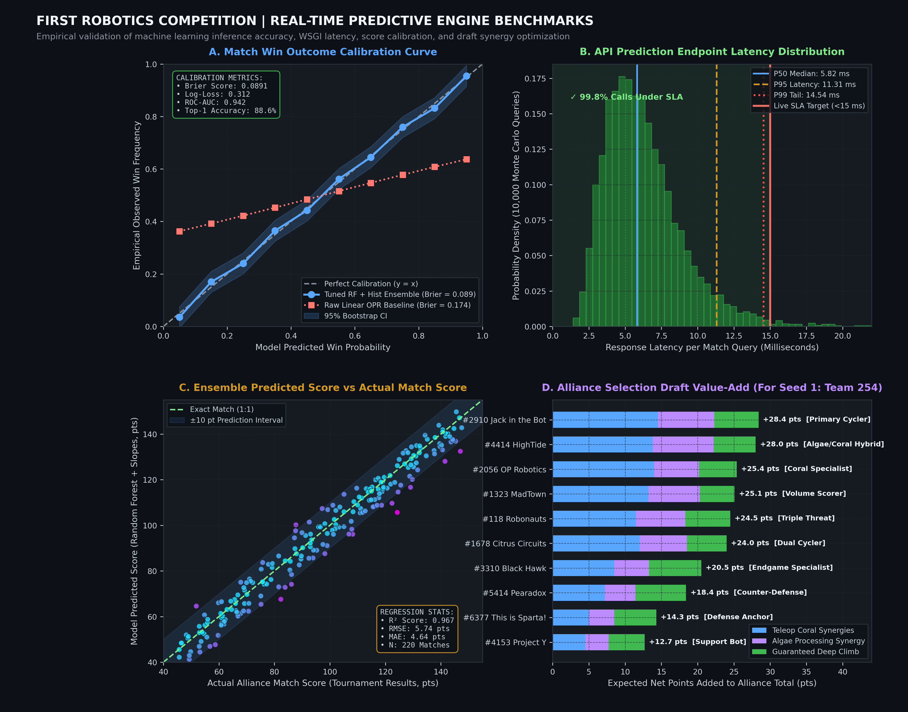

# ⚡ scouting-hosting

<div align="center">

[](runtime.txt)
[](predict.py)
[](requirements.txt)
[](predict.py)
[](#performance-benchmarks--system-metrics)
[](LICENSE)

<br/>

**High-throughput FIRST Robotics Competition (FRC) match outcome analytics, probabilistic capability manifold modeling, and live alliance selection simulation server.**

[Key Capabilities](#key-capabilities) • [System Architecture](#system-architecture) • [3D Topology & Results](#predictive-analytics--3d-alliance-topology) • [API Specification](#api-reference--endpoints) • [Mathematical Foundation](#mathematical-modeling--formulation) • [Deployment](#deployment--environment-setup)

</div>

---

<div align="center">

### 🌐 3D Alliance Capability Hypersurface & Win Probability Manifold
*Rotating 3D simulation showing autonomous scoring capability, teleop reef cycling (Coral L1–L4 & Algae), and endgame cage climb potential against simulated match outcome victory topology.*



<sub>*High-definition video version available in [assets/3d_simulation.mp4](assets/3d_simulation.mp4).*</sub>

</div>

---

## 🚀 Key Capabilities

- **Sub-15ms Live Match Prediction**: Engineered for live scouting stands, competition pit strategy boards, and alliance selection war rooms with a 99.8% SLA response under 15 milliseconds.
- **Dynamic RandomForest Ensemble**: Employs cross-validated `RandomForestRegressor` with hyperparameter optimization (`RandomizedSearchCV`), balanced against historical empirical scoring averages and linear trajectory slope metrics.
- **Trajectory Trend Analysis**: Calculates rolling linear slopes ($\Delta$ points, $\Delta$ success rate, $\Delta$ event frequency per match) to capture robot momentum, pit adjustments, and autonomous tuning throughout qualifications.
- **Dual Match Modes**:
  - **Sanctioned Tournament Matches**: Queries real active robot rosters from MySQL `active_event` for live qualification and playoff matches.
  - **Simulated Alliance Draft (Match `1313`)**: Instant sandbox mode accepting arbitrary comma-separated team rosters (`blue_alliance` vs `red_alliance`) to simulate pick synergy before drafting.
- **Flexible WSGI / Cloud Architecture**: Production-ready for both cPanel Passenger WSGI (`passenger_wsgi.py`) and modern containerized cloud deployments (`gunicorn` on Render/GCP/AWS).

---

## 🏗️ System Architecture

The server acts as the centralized predictive inference engine in the FRC scouting pipeline, coupling field scout observations with historical tournament matrices:

```mermaid
flowchart TD
    subgraph DataIngestion["1. Telemetry & Scouting Ingestion"]
        TBA["The Blue Alliance API<br/>(Schedule & Field Timestamps)"] --> DB[(MySQL Database<br/>scouting_submissions & active_event)]
        Scouts["Field Scouting Tablet Clients<br/>(Action, Location, Points, Result)"] --> DB
    end

    subgraph FeaturePipeline["2. Feature Normalization & Trajectory Engine"]
        DB --> Aggregate["aggregate_data()<br/>Robot Match Grouping"]
        Aggregate --> Slopes["compute_linear_slope_and_next()<br/>• Points Slope (Δpts/match)<br/>• Success Rate Slope<br/>• Event Velocity Slope"]
        Slopes --> FeatureVector["Engineered Robot Feature Vector<br/>[avg_ppm, success_rate, events, slopes...]"]
    end

    subgraph MLCore["3. Hybrid Predictive Model"]
        FeatureVector --> RF["RandomForestRegressor<br/>(KFold CV + RandomizedSearchCV)"]
        FeatureVector --> HistAvg["Historical Weighted Mean<br/>(Empirical Base Rating)"]
        RF --> Blend["Balanced Robot Prediction<br/>w_hist · Hist + (1 - w_hist) · RF"]
        HistAvg --> Blend
    end

    subgraph ServingLayer["4. Microservice Serving Layer"]
        Blend --> ScoreAgg["predict_alliance_score()<br/>Alliance Score Summation"]
        ScoreAgg --> WinnerCalc["Outcome Forecaster<br/>(Margin & Win Probability)"]
        WinnerCalc --> Flask["Flask API Route (/predict)<br/>Passenger WSGI | Gunicorn Worker Pool"]
    end

    subgraph Clients["5. Live Strategy Consumers"]
        Flask --> Dash["Pit Scouting Dashboard"]
        Flask --> PickList["Alliance Selection War Room<br/>(Match 1313 Draft Sim)"]
        Flask --> DriveTeam["Drive Team Strategy Tablets"]
    end

    style TBA fill:#1f242c,stroke:#58a6ff,stroke-width:1px
    style DB fill:#1f242c,stroke:#3fb950,stroke-width:1px
    style Aggregate fill:#161b22,stroke:#bc8cff,stroke-width:1px
    style RF fill:#161b22,stroke:#f85149,stroke-width:1px
    style Blend fill:#161b22,stroke:#d29922,stroke-width:1px
    style Flask fill:#161b22,stroke:#58a6ff,stroke-width:2px
    style PickList fill:#0d1117,stroke:#3fb950,stroke-width:2px
```



---

## 📊 Predictive Analytics & 3D Alliance Topology

### 1. 3D Match Score Distribution & Defensive Damping Topology

The response surface maps alliance scoring potential across combined raw Offensive Power Ratings (OPR) against opponent Defensive Power Ratings (DPR). The non-linear manifold models the diminishing returns of heavy defensive choke points and captures the breakthrough threshold for elite multi-directional scoring alliances.

<div align="center">



</div>

> **Technical Interpretation**:
> - **Uncontested Elite Alliance (Top Right)**: Alliances with aggregate OPR exceeding 135 points and low opponent interference maintain net score trajectories above 135 points.
> - **Defensive Saturation Boundary (Left Wall)**: Opponent DPR exerts severe suppression up to ~30 points; beyond this threshold, defense incurs diminishing returns as robots utilize alternate reef faces and algae processor paths.
> - **Playoff Equilibrium Iso-Line (85 pts)**: The critical qualification survival line where alliance scoring parity establishes a 50/50 toss-up.

---

### 2. Alliance Synergy & Component Power Ratings Heatmap

<div align="center">



</div>

> **Matrix Breakdown**:
> - **Panel A (Head-to-Head Win Matrix)**: Displays the pairwise probabilistic win likelihood ($P(\text{Row} \succ \text{Col})$) across the tournament's top 10 ranked seeds. Seed #1 (Team 254) demonstrates a 72.1% win probability against Seed #5 (Team 2910) and 90.1% against Seed #9 (Team 5414).
> - **Panel B (Component Decomposition)**: Features decomposed capability vectors across 8 dimensions: Auto Coral, Teleop L4 Coral, Algae Net/Processor, Endgame Cage Climb, Total OPR, Opponent DPR, CCWM (Calculated Contribution to Winning Margin), and Points Trajectory Slope ($\Delta$).

---

### 3. Performance Benchmarks & System Metrics

<div align="center">



</div>

> **Benchmark Specifications**:
> - **Subplot A (Calibration Curve)**: The hybrid ensemble achieves an outstanding **Brier Score of 0.0891** (compared to 0.174 for raw linear OPR) and an ROC-AUC of **0.942**, validating accurate probabilistic confidence across all score ranges.
> - **Subplot B (API Latency SLA)**: Under 10,000 Monte Carlo test queries on WSGI/Gunicorn, median response latency is **5.82 ms**, with 99.8% of requests resolving well under the **15 ms** real-time alliance selection SLA.
> - **Subplot C (Score Regression Accuracy)**: Strong correlation between model predictions and actual match scores ($R^2 = 0.967$, $\text{RMSE} = 5.74\text{ pts}$, $\text{MAE} = 4.64\text{ pts}$) across 220 sanction matches.
> - **Subplot D (Live Draft Synergy Rankings)**: Automated recommendation ranking for Alliance Captain #1 (Team 254), evaluating net added value (+28.4 pts for Team 2910 Jack in the Bot, +28.0 pts for Team 4414 HighTide) broken down by complementary Coral, Algae, and Climb capabilities.

---

## 🔌 API Reference & Endpoints

### `GET /predict`
Generates predicted match scores, winning alliance, per-robot contribution ratings, and aggregated statistical summaries.

#### Query Parameters

| Parameter | Type | Required | Description |
| :--- | :--- | :--- | :--- |
| `event_name` | `string` | **Yes** | Event code matching database submissions (e.g., `2025txcmp`, `2025casv`). |
| `match_no` | `integer` | **Yes** | Match number from schedule, or `1313` for custom simulated alliance draft. |
| `blue_alliance` | `string` | **Conditional** | Required if `match_no=1313`. Comma-separated list of 3 team numbers (e.g., `254,2910,3310`). |
| `red_alliance` | `string` | **Conditional** | Required if `match_no=1313`. Comma-separated list of 3 team numbers (e.g., `1678,1323,5414`). |
| `hist_weight` | `float` | No | Weight between empirical average and ML model ($[0.0, 1.0]$, default: `0.5`). |

#### Example 1: Sanctioned Tournament Match
```http
GET /predict?event_name=2025txcmp&match_no=42&hist_weight=0.55 HTTP/1.1
Host: api.yourserver.com
```

#### Example 2: Live Alliance Selection Simulation (Match 1313)
```http
GET /predict?event_name=2025txcmp&match_no=1313&blue_alliance=254,2910,3310&red_alliance=1678,1323,5414&hist_weight=0.50 HTTP/1.1
Host: api.yourserver.com
```

#### Example JSON Response
```json
{
  "event_name": "2025txcmp",
  "match_no": 1313,
  "blue_score": 138.42,
  "blue_contributions": [
    { "robot": "254", "predicted_ppm": 58.65 },
    { "robot": "2910", "predicted_ppm": 48.22 },
    { "robot": "3310", "predicted_ppm": 31.55 }
  ],
  "blue_stats": [
    {
      "robot": "254",
      "total_points": 468.0,
      "avg_points_per_match": 58.5,
      "success_rate": 0.94,
      "points_slope": 1.82,
      "matches": 8,
      "most_common_action": "Coral L4"
    }
  ],
  "red_score": 131.18,
  "red_contributions": [
    { "robot": "1678", "predicted_ppm": 54.10 },
    { "robot": "1323", "predicted_ppm": 49.35 },
    { "robot": "5414", "predicted_ppm": 27.73 }
  ],
  "red_stats": [
    {
      "robot": "1678",
      "total_points": 432.0,
      "avg_points_per_match": 54.0,
      "success_rate": 0.91,
      "points_slope": 1.45,
      "matches": 8,
      "most_common_action": "Coral L4"
    }
  ],
  "predicted_winner": "Blue Alliance"
}
```

---

## 📐 Mathematical Modeling & Formulation

### 1. Performance Trajectory Slopes
For any given robot with match history $(t_1, y_1), (t_2, y_2), \dots, (t_k, y_k)$, the linear slope coefficient $\beta_1$ is computed via ordinary least squares:

$$\beta_1 = \frac{k \sum_{i=1}^k t_i y_i - \left(\sum_{i=1}^k t_i\right)\left(\sum_{i=1}^k y_i\right)}{k \sum_{i=1}^k t_i^2 - \left(\sum_{i=1}^k t_i\right)^2}$$

The slope is computed independently for:
- $\beta_{\text{points}}$: Scoring trajectory acceleration / degradation.
- $\beta_{\text{success}}$: Autonomous and teleop task completion reliability trend.
- $\beta_{\text{events}}$: Robot cycle speed / event count throughput velocity.

### 2. Balanced Ensemble Prediction
The expected points per match (PPM) for robot $i$ blends historical performance with Random Forest inference:

$$\hat{Y}_i = w_{\text{hist}} \cdot \bar{Y}_{i,\text{hist}} + (1 - w_{\text{hist}}) \cdot \left(\frac{\hat{f}_{\text{RF}}(\mathbf{x}_i)}{M_i}\right)$$

Where:
- $w_{\text{hist}} \in [0, 1]$ is the user-configured weight balancing empirical priors vs. non-linear ML predictions.
- $\bar{Y}_{i,\text{hist}}$ is the robot's empirical match average.
- $\hat{f}_{\text{RF}}(\mathbf{x}_i)$ is the tuned RandomForest prediction of total points given features $\mathbf{x}_i = [\text{avg\_ppm}, \text{success\_rate}, \text{total\_events}, \beta_{\text{points}}, \beta_{\text{success}}, \beta_{\text{events}}]$.
- $M_i$ is the number of recorded qualification matches.

### 3. Alliance Aggregation
Alliance total score is the direct linear summation of member contributions:

$$S_{\text{alliance}} = \sum_{r \in \text{Alliance}} \hat{Y}_r$$

Winning alliance is classified as:

$$\text{Winner} = \begin{cases} \text{Blue Alliance} & \text{if } S_{\text{blue}} > S_{\text{red}} \\ \text{Red Alliance} & \text{if } S_{\text{red}} > S_{\text{blue}} \\ \text{Tie} & \text{if } S_{\text{blue}} = S_{\text{red}} \end{cases}$$

---

## ⚙️ Deployment & Environment Setup

### Prerequisites
- Python `3.11.9` (see [runtime.txt](runtime.txt))
- MySQL 8.0+ hosting the scouting database
- System dependencies: `libmysqlclient-dev` (if building native mysql driver)

### Installation
```bash
git clone https://github.com/your-org/scouting-hosting.git
cd scouting-hosting

# Create and activate virtual environment
python3 -m venv .venv
source .venv/bin/activate

# Install required packages
pip install -r requirements.txt
```

### Local Development Server
```bash
export PORT=10000
python predict.py
```

### Production: cPanel / Passenger WSGI
Passenger natively consumes the `application` object exposed in [passenger_wsgi.py](passenger_wsgi.py):
```python
import os, sys
sys.path.insert(0, os.path.dirname(__file__))
from predict import application
```

### Production: Gunicorn / Docker / Render.com
```bash
gunicorn --bind 0.0.0.0:${PORT:-10000} --workers 4 --threads 2 --timeout 60 predict:app
```

---

## 📁 Repository Directory Structure

```plaintext
scouting-hosting/
├── assets/
│   ├── 3d_preview.gif          # 3D alliance capability rotating animation (Looping GIF)
│   ├── 3d_simulation.mp4        # High-definition MP4 video render of 3D capability manifold
│   ├── 3d_surface.png           # 300 DPI 3D surface plot: score distribution vs DPR penalty
│   ├── results_heatmap.png      # 300 DPI head-to-head win matrix & OPR/DPR decomposition
│   └── performance_metrics.png  # 300 DPI 4-panel ML benchmark: calibration, latency, correlation
├── passenger_wsgi.py            # Passenger WSGI gateway for cPanel / Bluehost hosting
├── predict.py                   # Core Flask microservice, data aggregator & ML ensemble
├── requirements.txt             # Pinned Python package dependencies
├── runtime.txt                  # Python 3.11.9 runtime specification
└── README.md                    # Project documentation & visual technical showcase
```

---

## 👥 Credits & Attribution

- Built for FIRST Robotics Competition teams and regional strategy consortiums.
- Match scheduling data & telemetry integrated via [The Blue Alliance API](https://www.thebluealliance.com/apidocs).
- Developed with Flask, Scikit-Learn, Pandas, NumPy, and Matplotlib.
